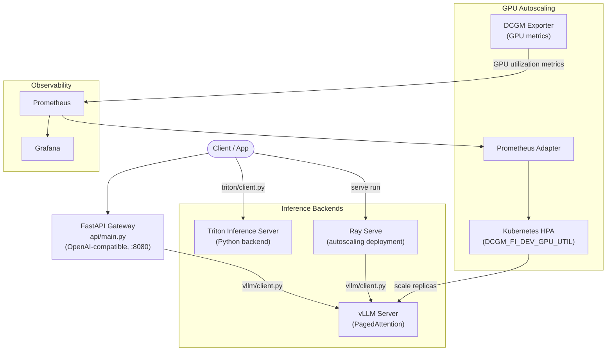

# model-serving-stack

> **Reference stack for serving LLMs on NVIDIA GPUs** — an OpenAI-compatible FastAPI gateway in front of vLLM, alongside Triton Inference Server and Ray Serve deployments, DCGM-driven Kubernetes autoscaling, Prometheus/Grafana observability, and a BentoML packaging path.

[](https://github.com/TylrDn/model-serving-stack/actions)
[](https://python.org)
[](LICENSE)

---

Serving an LLM well is mostly an infrastructure problem: which runtime you pick changes latency by tens of percent, and the autoscaling signal you pick decides whether you scale before or after users feel it. This repo puts three common runtimes — vLLM, Triton Inference Server, and Ray Serve — behind one OpenAI-compatible API surface, alongside the Kubernetes, monitoring, and benchmarking pieces needed to compare and operate them. It is a reference implementation and a benchmarking harness, not a hosted service; every number quoted here comes from a committed artifact in [`results/`](results/).

## Architecture



The gateway itself calls vLLM only; Triton and Ray Serve are deployed and addressed independently. See [docs/configuration.md](docs/configuration.md#there-is-no-backend-selector).

## Stack Components

| Component | Role | Key Config |
|-----------|------|------------|
| **FastAPI Gateway** | OpenAI-compatible `/v1/chat/completions`, `/v1/models`, `/health` on port `8080` | `api/main.py` |
| **vLLM** | High-throughput LLM inference with PagedAttention | `vllm/server.py`, `vllm/batching_config.yaml` |
| **Triton Inference Server** | Model repository whose Python backend wraps a vLLM engine | `triton/model_repository/llama3/` |
| **Ray Serve** | Autoscaling deployment and multi-model traffic split | `ray_serve/deployment.py`, `ray_serve/multi_model_router.py` |
| **BentoML** | Portable model packaging | `bentoml/service.py`, `bentoml/bentofile.yaml` |
| **DCGM Exporter + HPA** | GPU utilization metrics driving pod autoscaling | `kubernetes/dcgm-exporter.yaml`, `kubernetes/hpa-dcgm.yaml` |
| **Prometheus + Grafana** | Scrape config and GPU serving dashboard | `monitoring/prometheus/prometheus.yml`, `monitoring/grafana/gpu_serving_dashboard.json` |

---

## Quick Start

### 1. Prerequisites

- NVIDIA GPU and driver (the Compose services request `nvidia` GPU devices; `kubernetes/vllm-deployment.yaml` requests `nvidia.com/gpu: 1`)
- Docker + [NVIDIA Container Toolkit](https://docs.nvidia.com/datacenter/cloud-native/container-toolkit/install-guide.html)
- Python 3.11+ (`requires-python = ">=3.11"`)

### 2. Environment

```bash
cp .env.template .env
```

The variables the code actually reads:

| Variable | Default | Read by |
|----------|---------|---------|
| `MODEL_NAME` | `meta/llama3-8b-instruct` | `vllm/client.py`, `vllm/server.py` |
| `VLLM_HOST` | `localhost` (client), `0.0.0.0` (server) | `vllm/client.py`, `vllm/server.py` |
| `VLLM_PORT` | `8000` | `vllm/client.py`, `vllm/server.py` |
| `TENSOR_PARALLEL_SIZE` | `1` | `vllm/server.py` |
| `MAX_MODEL_LEN` | `8192` | `vllm/server.py` |
| `VLLM_MODEL_NAME` | `meta-llama/Meta-Llama-3-8B-Instruct` | `vllm/openai_server.py`, root `docker-compose.yml` |
| `VLLM_TENSOR_PARALLEL_SIZE` | `1` | `vllm/openai_server.py` |
| `TRITON_HOST` / `TRITON_HTTP_PORT` / `TRITON_GRPC_PORT` | `localhost` / `8000` / `8001` | `triton/client.py` |
| `PROMETHEUS_PORT` / `GRAFANA_PORT` | `9090` / `3000` | root `docker-compose.yml` |
| `MODEL_PATH` / `HF_TOKEN` | — | `deploy/docker-compose.yml` |

`.env.template` also ships `NGC_API_KEY`, `NVIDIA_API_KEY`, `TRITON_METRICS_PORT`, `RAY_ADDRESS`, `RAY_SERVE_PORT` and `LANGCHAIN_*`, which no module in this repo reads — they exist for the surrounding tooling. Full details, including YAML file ownership, are in [docs/configuration.md](docs/configuration.md).

### 3. Run

```bash
# Gateway (:8080) + vLLM + Prometheus + Grafana
docker compose -f deploy/docker-compose.yml up

# Or backends only: Triton (:8000/:8001/:8002), vLLM (:8010), Prometheus, Grafana
docker compose up
```

Without Docker, run the pieces directly from the repository root:

```bash
python -m vllm.server                              # vLLM on :8000
uvicorn api.main:app --host 0.0.0.0 --port 8080    # gateway on :8080
```

### 4. Verify

```bash
# Gateway health (includes a vLLM readiness probe)
curl http://localhost:8080/health

# Models advertised from configs/models.yaml
curl http://localhost:8080/v1/models

# Run a completion
curl http://localhost:8080/v1/chat/completions \
  -H "Content-Type: application/json" \
  -d '{
    "model": "llama3-8b",
    "messages": [{"role": "user", "content": "Hello!"}]
  }'
```

---

## Configuration

Environment variables are read at process start (`python-dotenv` does not override anything already exported), and `configs/models.yaml` is the only YAML file loaded by application code — it populates `GET /v1/models`. There is no `SERVING_BACKEND` selector: the gateway always calls vLLM. See [docs/configuration.md](docs/configuration.md).

---

## Kubernetes Deployment

```bash
# DCGM exporter DaemonSet (namespace: monitoring)
kubectl apply -f kubernetes/dcgm-exporter.yaml

# Serving workloads (Deployment + Service in each file)
kubectl apply -f kubernetes/vllm-deployment.yaml
kubectl apply -f kubernetes/triton-deployment.yaml

# HPA on DCGM_FI_DEV_GPU_UTIL, AverageValue target 70
kubectl apply -f kubernetes/hpa-dcgm.yaml

# Optional NGINX ingress for /vllm and /triton
kubectl apply -f kubernetes/ingress.yaml

kubectl get hpa vllm-gpu-hpa
```

The HPA scales the `vllm-server` Deployment between 1 and 4 replicas on the DCGM Exporter's `DCGM_FI_DEV_GPU_UTIL` metric. It requires [Prometheus Adapter](https://github.com/kubernetes-sigs/prometheus-adapter) to expose that metric through the Kubernetes external metrics API. Rationale and tuning guidance: [docs/autoscaling.md](docs/autoscaling.md).

---

## Benchmarks

**This project publishes no performance numbers.** It has a benchmark harness;
it does not yet have a benchmark result.

The former baseline (`baseline_bench_2026-06.json`, vLLM vs Triton TRT-LLM vs
Ray Serve on an A10G) recorded no commit SHA, no command and no backend
versions, and no committed tool emitted its schema. It could not be reproduced
or checked, so it has been moved to
[`results/unverified/`](results/unverified/README.md) and is quoted nowhere. It
is kept for history, not offered as evidence.

What exists instead is `python -m evals.bench_report`, which measures
time-to-first-token from a streamed response across one or more named backends,
captures provenance from the running machine — commit SHA, the exact
invocation, package and CUDA driver versions, detected GPU — and **refuses to
write a report missing any of it**. Its `key_findings` are derived from the
measurements rather than written by hand, so a percentage cannot contradict the
numbers beside it. `tests/test_bench_report.py` enforces both properties, and
asserts that every file in `results/` satisfies the schema in
[`results/README.md`](results/README.md).

Producing a real baseline needs a GPU host; the command is in
[`results/unverified/README.md`](results/unverified/README.md). See
[docs/benchmarks.md](docs/benchmarks.md) for the harnesses and how to run them.

---

## Testing

```bash
pip install -r requirements.txt
pip install -e ".[dev]"

# Exactly what .github/workflows/ci.yml runs
ruff check .
pytest tests/ -v -m "not gpu" \
  --cov=api --cov=vllm --cov=triton --cov=evals \
  --cov-report=term-missing \
  --cov-fail-under=80
```

16 mock-based tests across six modules; measured coverage over the CI-scoped packages is 87% against an 80% gate. CI runs on `ubuntu-latest` with Python 3.11 and no GPU, so tests marked `@pytest.mark.gpu` are excluded. `mypy` is configured in `pyproject.toml` but is not part of CI. Coverage map and gaps: [docs/testing.md](docs/testing.md).

Load test against a running gateway:

```bash
python -m evals.load_test --requests 500 --concurrency 32 --output-dir results/load_tests
```

---

## Project Structure

```
model-serving-stack/
├── api/                          # OpenAI-compatible FastAPI gateway (port 8080)
│   ├── main.py                   # /v1/chat/completions, /v1/models, /health, StructuredLoggingMiddleware
│   └── models.py                 # Pydantic request/response schemas
├── vllm/                         # vLLM runtime
│   ├── server.py                 # Launches vllm.entrypoints.openai.api_server from env vars
│   ├── openai_server.py          # In-process FastAPI server over AsyncLLMEngine
│   ├── client.py                 # VLLMClient used by the gateway, Ray Serve and BentoML
│   ├── client_test.py            # Standalone load-test script (not a pytest module)
│   └── batching_config.yaml      # Continuous-batching reference values
├── triton/                       # Triton Inference Server
│   ├── client.py                 # HTTP/gRPC client wrapper
│   ├── perf_analyzer.sh          # perf_analyzer benchmark script
│   └── model_repository/llama3/  # config.pbtxt + 1/model.py (Python backend)
├── ray_serve/                    # Ray Serve
│   ├── deployment.py             # @serve.deployment with AutoscalingConfig
│   ├── multi_model_router.py     # Weighted traffic split across models
│   └── autoscaling_config.yaml   # Autoscaling reference values
├── bentoml/                      # BentoML packaging
│   ├── service.py                # Service + runner definition
│   ├── bentofile.yaml            # Build manifest
│   └── build_and_push.sh         # Build and push helper
├── kubernetes/                   # K8s manifests
│   ├── vllm-deployment.yaml      # Deployment + Service (nvidia.com/gpu: 1)
│   ├── triton-deployment.yaml    # Deployment + Service (HTTP/gRPC/metrics)
│   ├── dcgm-exporter.yaml        # DCGM Exporter DaemonSet
│   ├── hpa-dcgm.yaml             # HPA on DCGM_FI_DEV_GPU_UTIL (canonical)
│   └── ingress.yaml              # NGINX ingress for /vllm and /triton
├── monitoring/
│   ├── prometheus/prometheus.yml # Scrape configs (DCGM, vLLM, Triton)
│   └── grafana/gpu_serving_dashboard.json
├── configs/
│   ├── models.yaml               # Model registry read by the gateway
│   └── serving.yaml              # Reference backend settings
├── evals/
│   ├── benchmark.py              # Async latency/throughput harness
│   └── load_test.py              # CLI wrapper that writes a JSON report
├── results/                      # Committed benchmark artifacts + schema
│   ├── README.md
│   └── unverified/            # results that lack provenance; not evidence
├── tests/                        # pytest suite (6 modules, mock-based)
├── docs/                         # architecture, configuration, benchmarks, autoscaling, testing
├── deploy/                       # Dockerfile + Compose stack with the gateway
├── notebooks/serving_demo.ipynb
├── docker-compose.yml            # Root: Triton + vLLM + Prometheus + Grafana
├── pyproject.toml                # ruff, mypy, pytest, coverage config
└── requirements.txt
```

---

## Documentation

| Document | Contents |
|----------|----------|
| [docs/architecture.md](docs/architecture.md) | Component diagram, backend trade-offs, request flow, design decisions |
| [docs/configuration.md](docs/configuration.md) | Environment variables, YAML ownership, worked examples |
| [docs/benchmarks.md](docs/benchmarks.md) | Baseline results, rerun commands, reproducibility gap |
| [docs/autoscaling.md](docs/autoscaling.md) | DCGM-driven HPA: dependencies, apply order, tuning |
| [docs/testing.md](docs/testing.md) | Coverage map, uncovered areas, `gpu` marker |
| [results/README.md](results/README.md) | Required metadata schema for new benchmark artifacts |
| [CONTRIBUTING.md](CONTRIBUTING.md) · [CHANGELOG.md](CHANGELOG.md) · [SECURITY.md](SECURITY.md) · [CODE_OF_CONDUCT.md](CODE_OF_CONDUCT.md) | Workflow, release history, security policy, conduct |

---

## Related Repos

Sibling reference projects by the same author. They are independent repositories, not runtime dependencies of this one.

| Repo | Relationship |
|------|--------------|
| [`nvidia-nim-agent-toolkit`](https://github.com/TylrDn/nvidia-nim-agent-toolkit) | Multi-agent toolkit over NVIDIA NIM — the client side of a serving stack like this |
| [`inference-optimization-bench`](https://github.com/TylrDn/inference-optimization-bench) | Quantization and inference benchmarking (GGUF, AWQ, GPTQ) that informs backend choice |
| [`llm-finetuning-lab`](https://github.com/TylrDn/llm-finetuning-lab) | LoRA/QLoRA fine-tuning pipeline producing weights that a stack like this serves |

---

## License

MIT — see [LICENSE](LICENSE).
