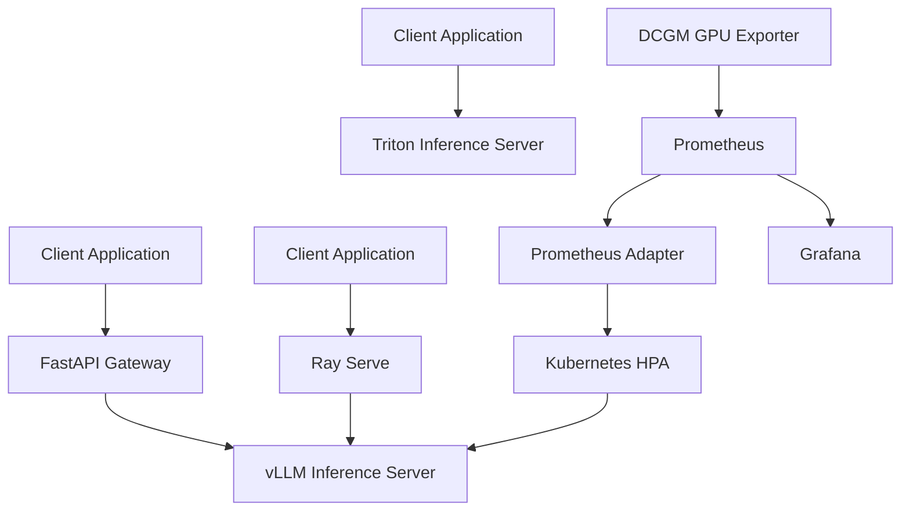

# LLM Model Serving Stack

A reference implementation for serving large language models on NVIDIA GPUs using an OpenAI-compatible FastAPI gateway, vLLM, Triton Inference Server, Ray Serve, Kubernetes autoscaling, and Prometheus/Grafana monitoring.

This project demonstrates how to build, benchmark, deploy, and monitor high-performance LLM inference infrastructure.

It is designed as a reference implementation and benchmarking environment, not a hosted production service.

## Overview

Serving large language models efficiently requires more than loading a model onto a GPU.

Important considerations include:

- Inference latency
- Token throughput
- GPU memory efficiency
- Request batching
- Concurrent execution
- Model deployment
- Autoscaling
- Resource monitoring
- Performance benchmarking

This project integrates multiple serving technologies into one infrastructure reference.

The stack includes:

| Component | Purpose |
|-----------|---------|
| FastAPI | OpenAI-compatible inference gateway |
| vLLM | High-throughput model inference |
| Triton Inference Server | GPU inference serving |
| Ray Serve | Distributed inference deployment |
| BentoML | Model packaging |
| Kubernetes | Container orchestration |
| DCGM Exporter | GPU utilization metrics |
| Prometheus | Metrics collection |
| Grafana | Monitoring dashboards |

The FastAPI gateway communicates directly with vLLM. Triton and Ray Serve operate as independently accessible deployments.

## Architecture



### Architecture Components

**API Gateway**

Provides a standardized interface for model inference, health checks, and model discovery.

**Inference Backends**

Support multiple execution architectures for GPU-accelerated inference.

**Autoscaling**

Uses GPU utilization metrics to adjust serving capacity.

**Observability**

Collects performance metrics and supports infrastructure monitoring.

## Features

- OpenAI-compatible REST API
- GPU-accelerated LLM inference
- Continuous batching
- PagedAttention support
- Distributed serving reference
- Multiple inference runtimes
- Kubernetes deployment configurations
- GPU-based horizontal autoscaling
- Prometheus metrics
- Grafana dashboards
- Automated performance benchmarking
- Model packaging
- Containerized deployment
- Mock-based testing
- CI quality checks

## Requirements

### Hardware

- NVIDIA GPU
- Compatible NVIDIA driver
- Sufficient GPU memory for the selected model

### Software

- Python 3.11+
- Docker
- Docker Compose
- NVIDIA Container Toolkit
- Kubernetes for cluster deployment

Hardware requirements depend on model size, precision, and concurrency.

## Quick Start

### 1. Configure the Environment

Create the environment file:

```bash
cp .env.template .env
```

Update the configuration for your GPU and selected model.

### 2. Environment Variables

| Variable | Default |
|----------|---------|
| MODEL_NAME | meta/llama3-8b-instruct |
| VLLM_HOST | localhost |
| VLLM_PORT | 8000 |
| TENSOR_PARALLEL_SIZE | 1 |
| MAX_MODEL_LEN | 8192 |
| VLLM_MODEL_NAME | meta-llama/Meta-Llama-3-8B-Instruct |
| VLLM_TENSOR_PARALLEL_SIZE | 1 |
| PROMETHEUS_PORT | 9090 |
| GRAFANA_PORT | 3000 |

Additional configuration includes:

- TRITON_HOST
- TRITON_HTTP_PORT
- TRITON_GRPC_PORT
- MODEL_PATH
- HF_TOKEN
- NGC_API_KEY
- NVIDIA_API_KEY
- RAY_ADDRESS
- RAY_SERVE_PORT

Not every variable is consumed directly by application code.

Environment variables are loaded at process startup.

## Running the Stack

### Docker Deployment

Start the FastAPI gateway, vLLM, Prometheus, and Grafana:

```bash
docker compose -f deploy/docker-compose.yml up
```

Alternatively, start the root Compose services:

```bash
docker compose up
```

The root configuration includes:

- Triton Inference Server
- vLLM
- Prometheus
- Grafana

### Manual Deployment

Launch the vLLM server:

```bash
python -m vllm.server
```

Start the FastAPI gateway:

```bash
uvicorn api.main:app --host 0.0.0.0 --port 8080
```

### API Endpoints

The gateway exposes:

| Endpoint | Method | Purpose |
|----------|--------|---------|
| `/health` | GET | Health and readiness check |
| `/v1/models` | GET | Available model discovery |
| `/v1/chat/completions` | POST | Chat inference |

Example inference payload:

```json
{
  "model": "llama3-8b",
  "messages": [
    {
      "role": "user",
      "content": "Hello!"
    }
  ]
}
```

The gateway currently routes inference requests to vLLM only.

There is no automatic backend selection in the gateway.

## Inference Backends

### vLLM

vLLM provides high-throughput model serving with efficient GPU memory management.

Capabilities include:

- PagedAttention
- Continuous batching
- Efficient KV-cache management
- Concurrent request processing
- Tensor parallelism
- OpenAI-compatible inference

Primary implementation files:

```text
vllm/server.py
vllm/openai_server.py
vllm/client.py
vllm/batching_config.yaml
```

### Triton Inference Server

Triton provides model serving infrastructure for GPU-accelerated workloads.

This implementation includes:

- Python backend integration
- Model repository configuration
- HTTP and gRPC client support
- Performance analysis tooling

Important files:

```text
triton/client.py
triton/perf_analyzer.sh
triton/model_repository/llama3/
```

### Ray Serve

Ray Serve supports distributed inference deployment and autoscaling.

The implementation demonstrates:

- Autoscaling configuration
- Multiple model deployments
- Weighted traffic distribution
- Integration with vLLM

Important files:

```text
ray_serve/deployment.py
ray_serve/multi_model_router.py
ray_serve/autoscaling_config.yaml
```

### BentoML

BentoML provides a packaging path for portable model services.

Files:

```text
bentoml/service.py
bentoml/bentofile.yaml
bentoml/build_and_push.sh
```

## Kubernetes Deployment

The project includes Kubernetes manifests for GPU inference infrastructure.

### GPU Metrics Exporter

Deploy DCGM Exporter:

```bash
kubectl apply -f kubernetes/dcgm-exporter.yaml
```

### Inference Deployments

Deploy vLLM:

```bash
kubectl apply -f kubernetes/vllm-deployment.yaml
```

Deploy Triton:

```bash
kubectl apply -f kubernetes/triton-deployment.yaml
```

### GPU Autoscaling

Enable horizontal pod autoscaling:

```bash
kubectl apply -f kubernetes/hpa-dcgm.yaml
```

Verify the autoscaler:

```bash
kubectl get hpa vllm-gpu-hpa
```

### Ingress

Apply the optional NGINX ingress configuration:

```bash
kubectl apply -f kubernetes/ingress.yaml
```

### Autoscaling Configuration

The reference autoscaler uses:

| Parameter | Value |
|-----------|-------|
| Deployment | vllm-server |
| Minimum replicas | 1 |
| Maximum replicas | 4 |
| GPU metric | DCGM_FI_DEV_GPU_UTIL |
| Target AverageValue | 70 |

Prometheus Adapter is required to expose the GPU metric through the Kubernetes external metrics API.

The autoscaler responds to GPU utilization rather than request count alone.

## Monitoring and Observability

### Prometheus

Prometheus collects serving and infrastructure metrics.

Tracked metrics can include:

- GPU utilization
- GPU memory usage
- Inference latency
- Request throughput
- Token generation performance
- Infrastructure resource consumption

Configuration:

```text
monitoring/prometheus/prometheus.yml
```

### Grafana

Grafana provides visualization dashboards for serving infrastructure.

Dashboard configuration:

```text
monitoring/grafana/gpu_serving_dashboard.json
```

The observability stack helps identify:

- GPU saturation
- Inference bottlenecks
- Serving performance changes
- Resource utilization
- Scaling behavior

## Benchmark Results

### Baseline Configuration

Recorded benchmark date: June 9, 2026.

Hardware and workload:

| Parameter | Value |
|-----------|-------|
| GPU | NVIDIA A10G |
| GPU memory | 24 GB |
| Model | Llama 3 8B Instruct |
| Requests | 500 |
| Concurrency | 32 |
| Average prompt tokens | 128 |
| Average output tokens | 256 |

### Performance Comparison

| Backend | TTFT p50 | TTFT p99 | Throughput | Requests/sec |
|---------|----------|----------|------------|--------------|
| vLLM | 142 ms | 387 ms | 1,840 tok/s | 28.4 |
| Triton TRT-LLM | 98 ms | 241 ms | 2,310 tok/s | 35.7 |
| Ray Serve with vLLM | 156 ms | 412 ms | 1,780 tok/s | 27.5 |

All measurements use concurrency 32.

### Benchmark Findings

The recorded baseline indicates that Triton achieved approximately 31% lower median time-to-first-token than native vLLM.

Additional findings suggest that vLLM's PagedAttention advantages become more significant at higher concurrency levels.

These findings are workload-specific and should not be treated as universal performance rankings.

### Reproducibility Limitation

The committed baseline results do not include complete execution provenance.

Missing metadata includes:

- Source commit identifier
- Exact benchmark commands
- Backend dependency versions

Therefore, the historical benchmark numbers are not fully reproducible from the repository alone.

Raw benchmark artifact:

```text
results/baseline_bench_2026-06.json
```

## Performance Testing

The project includes benchmarking tools for measuring inference performance.

### Load Testing

Run a load test against an active gateway:

```bash
python -m evals.load_test \
  --requests 500 \
  --concurrency 32 \
  --output-dir results/load_tests
```

### Evaluation Metrics

Performance testing covers:

- Time to first token
- Request latency
- Token throughput
- Requests per second
- Concurrent execution behavior
- Backend performance differences

Benchmark results are written to structured artifacts for further analysis.

## Testing

### Install Dependencies

```bash
pip install -r requirements.txt
pip install -e ".[dev]"
```

### Run Static Checks

```bash
ruff check .
```

### Run Unit Tests

```bash
pytest tests/ -v -m "not gpu"
```

### Coverage Testing

```bash
pytest tests/ -v -m "not gpu" \
  --cov=api \
  --cov=vllm \
  --cov=triton \
  --cov=evals \
  --cov-report=term-missing \
  --cov-fail-under=80
```

### Test Coverage

The reference test suite includes:

- 16 mock-based tests
- Six test modules
- 87% measured coverage for CI-scoped packages
- 80% minimum coverage requirement

The CI workflow runs on Ubuntu with Python 3.11.

GPU-dependent tests are excluded from the standard CI run.

Mypy configuration is included but is not part of the current CI pipeline.

## Project Structure

```text
project/
├── api/
│   ├── main.py
│   └── models.py
│
├── vllm/
│   ├── server.py
│   ├── openai_server.py
│   ├── client.py
│   ├── client_test.py
│   └── batching_config.yaml
│
├── triton/
│   ├── client.py
│   ├── perf_analyzer.sh
│   └── model_repository/
│       └── llama3/
│
├── ray_serve/
│   ├── deployment.py
│   ├── multi_model_router.py
│   └── autoscaling_config.yaml
│
├── bentoml/
│   ├── service.py
│   ├── bentofile.yaml
│   └── build_and_push.sh
│
├── kubernetes/
│   ├── vllm-deployment.yaml
│   ├── triton-deployment.yaml
│   ├── dcgm-exporter.yaml
│   ├── hpa-dcgm.yaml
│   └── ingress.yaml
│
├── monitoring/
│   ├── prometheus/
│   │   └── prometheus.yml
│   └── grafana/
│       └── gpu_serving_dashboard.json
│
├── configs/
│   ├── models.yaml
│   └── serving.yaml
│
├── evals/
│   ├── benchmark.py
│   └── load_test.py
│
├── results/
│   ├── README.md
│   └── baseline_bench_2026-06.json
│
├── tests/
│
├── docs/
│   ├── architecture.md
│   ├── configuration.md
│   ├── benchmarks.md
│   ├── autoscaling.md
│   └── testing.md
│
├── deploy/
│
├── notebooks/
│   └── serving_demo.ipynb
│
├── docker-compose.yml
├── pyproject.toml
└── requirements.txt
```

## Design Decisions

### OpenAI-Compatible API

A standardized inference API simplifies integration with applications and existing LLM clients.

The gateway currently supports model discovery and chat completions through vLLM.

### Multiple Serving Runtimes

Different inference workloads have different performance characteristics.

Supporting vLLM, Triton, and Ray Serve allows comparison of deployment architectures.

The backends are not automatically interchangeable through the gateway.

### GPU-Based Autoscaling

GPU utilization provides a resource-oriented scaling signal.

The HPA configuration demonstrates how DCGM metrics can drive Kubernetes replica counts.

### Containerized Infrastructure

Docker Compose supports local deployment.

Kubernetes manifests provide a reference for GPU-backed cluster operation.

### Reproducible Testing

Mock-based tests allow core application behavior to be validated without GPU hardware.

Separate benchmarking tools evaluate serving performance.

### Infrastructure Observability

Prometheus and Grafana provide visibility into serving and GPU infrastructure.

Monitoring is treated as part of the deployment architecture rather than an optional addition.

## Production Considerations

Before production deployment, evaluate:

- GPU availability and capacity
- Model memory requirements
- Inference concurrency
- Request timeouts
- Autoscaling thresholds
- Model loading and startup latency
- Authentication and authorization
- Network security
- Request logging
- Monitoring and alerting
- Dependency compatibility
- Deployment rollback procedures
- Benchmark reproducibility

This repository provides an infrastructure reference rather than a complete production-ready serving platform.

## Documentation

Additional technical documentation is organized under `docs/`.

| Document | Description |
|----------|-------------|
| architecture.md | Infrastructure architecture and request flow |
| configuration.md | Environment and serving configuration |
| benchmarks.md | Performance measurement and limitations |
| autoscaling.md | GPU-driven autoscaling configuration |
| testing.md | Unit tests, coverage, and CI behavior |

Additional repository documentation may include:

- CONTRIBUTING.md
- CHANGELOG.md
- SECURITY.md
- CODE_OF_CONDUCT.md
