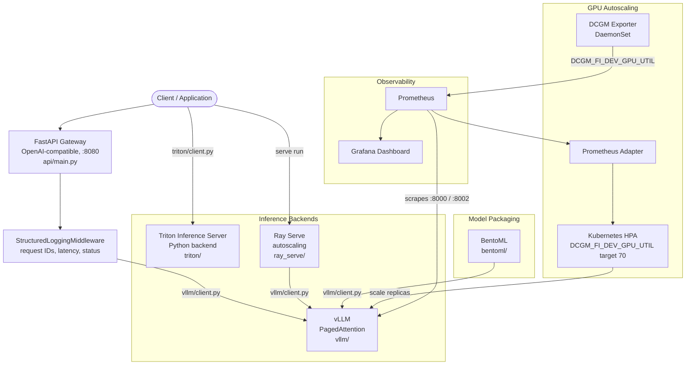

# Architecture — model-serving-stack

This document describes the design decisions, component interactions, and
operational patterns for the model-serving-stack.

## System Overview



The gateway has exactly one backend: `api/main.py` constructs a `VLLMClient` at
import time and every chat completion goes to vLLM. Triton and Ray Serve are
first-class parts of the stack but are addressed directly, not through the
gateway. See [configuration.md](configuration.md#there-is-no-backend-selector).

## Design Decisions

### Why three backends instead of one?

Each backend serves a different operational profile:

- **vLLM** — best for dynamic batching at high concurrency. PagedAttention
  prevents KV cache fragmentation. It is the default and the only backend the
  gateway calls.
- **Triton** — best for latency-critical serving and multi-model hosting. In the
  committed baseline it showed ~31% lower TTFT p50 than native vLLM at
  concurrency 32 (142 ms -> 98 ms); see [benchmarks.md](benchmarks.md) for the
  caveats on that measurement. The model repository here uses Triton's Python
  backend wrapping a vLLM `AsyncLLMEngine`, which is the flexible path; a
  TRT-LLM engine would be compiled per GPU and swapped in behind the same
  `config.pbtxt` contract.
- **Ray Serve** — best when you need programmatic autoscaling policies, Python
  request preprocessing, or multi-model routing (see
  `ray_serve/multi_model_router.py`). The baseline recorded ~10% overhead versus
  native vLLM from actor scheduling.

Switching the gateway's backend currently requires a code change in
`api/main.py`; there is no environment-variable selector.

### Why DCGM for autoscaling instead of CPU/memory HPA?

LLM inference is GPU-bound, not CPU/memory-bound. A standard HPA on CPU
utilization triggers far too late (GPU saturated, CPU still low) or far too
early (GPU idle, CPU busy with Python overhead). GPU memory is no better as a
signal because vLLM pre-allocates its KV cache to `gpu_memory_utilization`, so
usage barely moves with load. `DCGM_FI_DEV_GPU_UTIL` measures GPU execution
engine utilization directly, which tracks real serving pressure.

The 70% target provides a buffer for request spikes before saturation turns into
queuing latency. Full rationale, dependencies, and tuning: [autoscaling.md](autoscaling.md).

### Why StructuredLoggingMiddleware at the gateway level?

Centralizing request logging at the gateway (rather than inside each backend)
means:

1. Every request gets a correlation `request_id`, returned as `X-Request-ID`.
2. Latency is measured from the client's perspective, not the backend's internal
   view.
3. Requests that fail before reaching a backend are still logged.

`/health` and `/metrics` are excluded from this logging so probes do not flood
the log. The middleware also stamps `X-Backend: vllm` on responses. It is
implemented in `api/main.py`; logs are emitted as `logging` records on the
`api.access` logger with structured `extra` fields, not exported to Prometheus.

## Triton Model Repository Structure

```
triton/model_repository/
└── llama3/
    ├── config.pbtxt         # model name, backend, transaction policy, tensors
    └── 1/
        └── model.py         # Python backend wrapping a vLLM AsyncLLMEngine
```

`config.pbtxt` specifies:

- `name: "llama3"`, `backend: "python"`
- `max_batch_size: 0` — batching is handled by the vLLM engine inside the model,
  not by Triton's dynamic batcher
- `model_transaction_policy { decoupled: true }` — allows streaming/decoupled
  responses
- Inputs: `text_input` (`TYPE_STRING`), optional `max_tokens` (`TYPE_INT32`),
  optional `temperature` (`TYPE_FP32`)
- Output: `text_output` (`TYPE_STRING`)
- `instance_group`: one `KIND_GPU` instance on GPU 0

## DCGM HPA Configuration

`kubernetes/hpa-dcgm.yaml` is the canonical HPA. It uses an external metric
sourced from the DCGM Prometheus Exporter:

```yaml
metrics:
  - type: External
    external:
      metric:
        name: DCGM_FI_DEV_GPU_UTIL
        selector:
          matchLabels:
            gpu: "0"
      target:
        type: AverageValue
        averageValue: "70"
```

It also sets scaling `behavior`: a 60-second scale-up stabilization window at
one pod per minute, and a 300-second scale-down window at one pod per two
minutes. This requires the
[Prometheus Adapter](https://github.com/kubernetes-sigs/prometheus-adapter) to
bridge DCGM metrics from Prometheus into the Kubernetes external metrics API.

## Request Flow (gateway path)

1. Client sends `POST /v1/chat/completions` to the FastAPI gateway on port 8080.
2. `StructuredLoggingMiddleware` assigns a `request_id` and records the start
   time.
3. The handler validates the body against the Pydantic schemas in
   `api/models.py`.
4. `VLLMClient.chat()` forwards the messages to the vLLM OpenAI-compatible
   server (`VLLM_HOST`/`VLLM_PORT`) using the `openai` SDK.
5. vLLM processes the request with PagedAttention KV cache management.
6. The gateway returns a complete `chat.completion` response. Streaming (SSE) is
   not implemented on this path; the request schema has no `stream` field.
7. The middleware logs method, path, status, latency, client IP and user agent,
   and sets `X-Request-ID` and `X-Backend` on the response.

Prometheus scrapes the backends directly — `vllm-server:8000` and
`triton-server:8002` per `monitoring/prometheus/prometheus.yml`. The gateway
itself does not currently expose a `/metrics` endpoint.

## Related Repos

Sibling reference projects by the same author; they are independent
repositories, not runtime dependencies of this one.

| Repo | Relationship |
|------|------------------|
| [`llm-finetuning-lab`](https://github.com/TylrDn/llm-finetuning-lab) | LoRA/QLoRA fine-tuning pipeline producing weights a stack like this serves |
| [`inference-optimization-bench`](https://github.com/TylrDn/inference-optimization-bench) | Quantization and inference benchmarking that informs backend selection |
| [`nvidia-nim-agent-toolkit`](https://github.com/TylrDn/nvidia-nim-agent-toolkit) | Agent toolkit over NVIDIA NIM — the client side of a serving stack |
